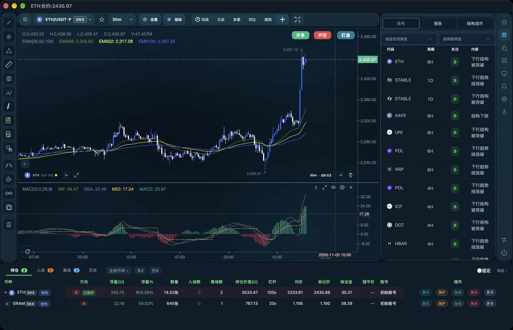

# 小二交易助手

面向**个人服务器**的加密交易助手：一套界面管多个交易所账户，合约为主、现货为辅。

数据都在你自己的机器上 —— 不经过任何第三方服务器。



---

## 能做什么

- **多交易所 / 多账户**：OKX、Bitget 统一到一套界面与一套字段
- **本地行情缓存**：K 线全量缓存 + 历史回补，断网也能看图
- **交易全流程**：下单 / 平仓 / 加仓 / 反手 / 网格 / 条件单 / 智能盯盘
- **单机私有部署**：配置与密钥只存在本机

## 环境要求

| 项 | 要求 |
|---|---|
| 系统 | Ubuntu 24.04（x86_64） |
| 权限 | root |
| 配置 | 2 核 / 2G 内存起，建议 4G |
| 网络 | 需要能访问 `github.com`（安装与更新都从这里拉取） |

## 安装

```bash
curl -fsSL https://github.com/liwubin2009/trade_assistant/releases/latest/download/install.sh -o /tmp/install_trade.sh
sudo bash /tmp/install_trade.sh
```

装完浏览器打开 `http://<你的服务器IP>/`，按页面提示配置交易所 API 即可。

## 升级

界面里点 **系统 → 状态 → 检查更新 → 升级** 就行（推荐）。

也可以在命令行：

```bash
curl -fsSL https://github.com/liwubin2009/trade_assistant/releases/latest/download/upgrade.sh -o /tmp/u.sh
sudo bash /tmp/u.sh              # 升级（已是最新版本会自动跳过）
sudo bash /tmp/u.sh --check      # 只看有没有新版本，不升级
sudo bash /tmp/u.sh --rollback   # 回滚到上一次升级前的备份
```

升级只替换程序文件；**配置、API 密钥、行情数据都会保留**。

## 常见问题

**「检查更新」失败？**
本机需要能访问 `github.com`。网络受限时会直接显示失败原因，不会假装"已是最新"。

**升级会不会丢配置 / 丢行情？**
不会。`configs/`（API 密钥）、`json/`、行情 CSV 都不在升级包里。

**能不能回退到上一个版本？**
可以，`upgrade.sh --rollback`；升级前会自动备份到 `backups/pre_<版本>_<时间>/`。

## 版本与下载

最新版本、更新说明都在 [Releases](https://github.com/liwubin2009/trade_assistant/releases)。
